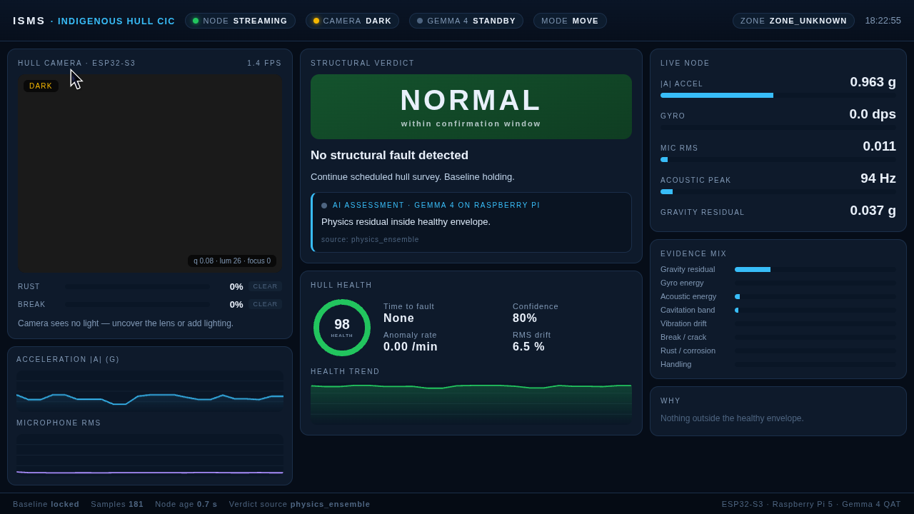
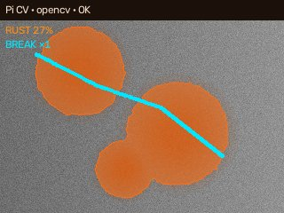
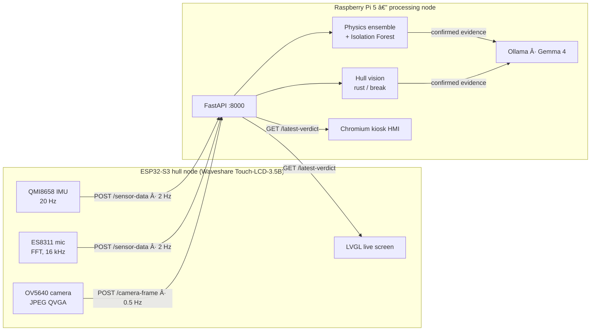

<div align="center">

# ISMS — Ship Structural Health Monitoring

**Contactless hull monitoring at the edge: an ESP32-S3 sensor node feeds a Raspberry Pi 5
that fuses vibration, acoustics and camera vision into a live structural verdict — no cloud.**

[](https://github.com/arunxo777/isms-ship-structural-health-monitor/actions/workflows/ci.yml)


[](LICENSE)



</div>

## What it does

A hull node clamped to a steel plate streams IMU, microphone and camera data over Wi-Fi.
The Raspberry Pi turns that into one answer a duty officer can act on — **NORMAL**, **WARNING**
or **CRITICAL** — with the reason, a health index, a time-to-fault trend and a recommended action.

- **Pose-invariant anomaly detection.** Tilting the node is not a crack. The engine works on
  gravity residual, gyro energy, acoustic envelope and 30 s vibration drift instead of raw
  accelerometer axes, and tags a picked-up node as *handling* rather than a hull fault.
- **Self-calibrating baseline.** The first 40 still, calibrated samples define the healthy hull;
  z-scores and CUSUM drift flag departures from it, and a fault must persist for three samples
  before the status escalates. An Isolation Forest on the invariant features corroborates, but
  never triggers on its own.
- **Hull vision that refuses to guess.** Dark, blown-out, blurred or featureless frames return
  *no evidence* instead of a score. Rust needs colour **and** granular structure; a break must be
  long, thin and higher-contrast than its surroundings (PCA on connected components). Every fault
  needs K-of-N temporal confirmation, so one odd frame never raises an alarm.
- **Local LLM explanation layer.** Gemma 4 (via Ollama, on the Pi CPU) phrases the verdict and can
  look at the frame. It never decides the status: the physics and vision stages do, and the model's
  wording is shown only while it agrees with them and is less than 90 s old.
- **Built for flaky links.** The node buffers readings to flash when Wi-Fi drops; the API acks
  camera uploads immediately and runs vision in the background so sensor posts are never starved.

<p align="center">
  <br>
  <sub>Vision overlay — corrosion in orange, a confirmed break traced in cyan.</sub>
</p>

## Architecture



More detail: [architecture](docs/architecture.md) · [hardware & pins](docs/hardware.md) ·
[HTTP API](docs/api.md) · [deploying to the Pi](docs/deployment.md)

## Quick start (no hardware)

```bash
git clone https://github.com/arunxo777/isms-ship-structural-health-monitor.git
cd isms-ship-structural-health-monitor/backend
python -m venv .venv && source .venv/bin/activate   # Windows: .venv\Scripts\activate
pip install -r requirements.txt
cp .env.example .env

python train_anomaly_model.py                       # writes anomaly_model.pkl
uvicorn server:app --host 0.0.0.0 --port 8000
```

Open <http://localhost:8000> for the HMI, then feed it a simulated hull in a second terminal:

```bash
python simulate_node.py --mode crack                # normal | bearing | cavitation | crack
```

Ollama is optional — without it the verdict text comes from the deterministic rule engine.
To enable it: `ollama pull gemma4:e2b-it-qat` and set `OLLAMA_HOST` in `.env`.

## Full system

| Step | Where | Guide |
| --- | --- | --- |
| 1. Flash the node | ESP32-S3 over USB | [firmware/esp-idf](firmware/esp-idf/README.md) |
| 2. Provision the Pi (API, Ollama, kiosk) | from your laptop over SSH | [docs/deployment.md](docs/deployment.md) |
| 3. Power on | node joins Wi-Fi and starts posting | — |

## Repository layout

```
backend/            FastAPI processing node (runs on the Pi)
  server.py           HTTP API and background vision / LLM tasks
  anomaly.py          physics ensemble, baseline, trends, Isolation Forest
  crack_detect.py     hull vision: quality gate, rust, break, confirmation
  ollama_client.py    Gemma 4 explanation layer with rule-engine fallback
  hmi/index.html      kiosk HMI served at /
  simulate_node.py    hardware-free sensor node
  tools/              vision probes and calibration utilities
  tests/              pytest suite
firmware/
  esp-idf/            primary node firmware (Waveshare BSP + ISMS app)
  arduino/            PlatformIO port of the same application logic
deploy/             SSH provisioning and ops scripts for the Raspberry Pi
scripts/            local launchers
docs/               architecture, hardware, API, deployment
```

## Development

```bash
pip install -r backend/requirements-dev.txt
ruff check .
pytest
```

The suite covers the HTTP contract, the physics engine, every vision control image on both the
OpenCV and pure-NumPy paths, and the end-to-end rule that a single stray frame never escalates
while a sustained fault does. CI also builds the firmware with ESP-IDF v5.4.4.

See [CONTRIBUTING.md](CONTRIBUTING.md).

## Acknowledgements

The node firmware is built on Waveshare's
[ESP32-S3-Touch-LCD-3.5B factory project](https://github.com/waveshareteam/ESP32-S3-Touch-LCD-3.5B)
and vendors [esp32-camera](https://github.com/espressif/esp32-camera) and
[XPowersLib](https://github.com/lewisxhe/XPowersLib) under their own licenses.

## License

[MIT](LICENSE)
