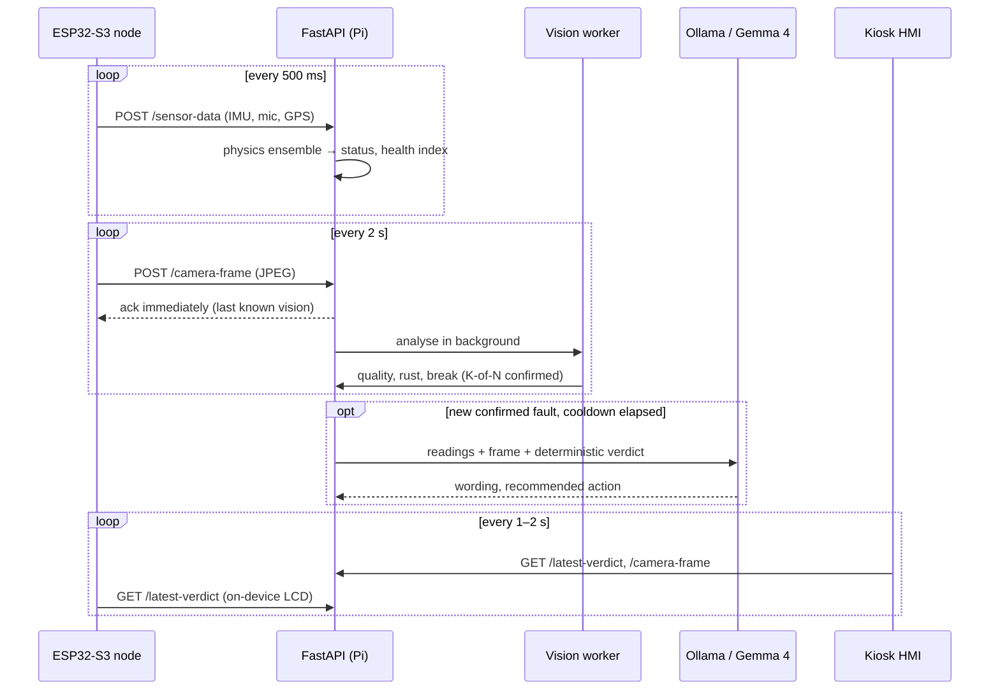

# Architecture

ISMS splits the work by what each device is good at. The ESP32-S3 samples sensors in real time
and survives Wi-Fi drops; the Raspberry Pi 5 does the fusion, vision and language work and drives
the operator display. Nothing leaves the local network.

## Data flow

## Sensor node (`firmware/esp-idf`)

FreeRTOS tasks, pinned so the sensor loop owns core 0:

| Task | Core | Period | Job |
| --- | --- | --- | --- |
| `isms_sens` | 0 | 50 ms | QMI8658 read, calibration, low-pass, stillness detection |
| `isms_mic` | 1 | 80 ms | ES8311 capture, RMS, 512-point FFT peak |
| `isms_post` | 1 | 500 ms | JSON POST; on failure, buffer to SPIFFS and replay later |
| `isms_cam` | 1 | 2 s | OV5640 JPEG QVGA upload |
| `isms_ui` | 1 | — | poll `/latest-verdict`, drive the LVGL screen |

The IMU is calibrated at boot (gravity vector, gyro bias, scale) and the microphone learns its
noise floor before streaming. A shared HTTP mutex gives sensor posts priority over camera uploads,
so a slow JPEG never starves the vibration stream.

## Processing node (`backend/`)

### Physics ensemble — `anomaly.py`

Raw accelerometer axes change whenever the node is tilted, so the detector works on
pose-invariant quantities:

| Signal | Meaning |
| --- | --- |
| Gravity residual `\| \|a\|/g − 1 \|` | mount shift or fatigue while the node is still |
| Gyro energy | rotation on a still node suggests loosening; while moving it is *handling* |
| Acoustic RMS and peak | bearing wear, cavitation band (200–800 Hz) |
| 30 s vibration RMS + CUSUM | slow drift away from the healthy baseline |
| Camera crack / rust | confirmed evidence from the vision stage |

The first 40 still, calibrated samples form a Welford baseline. Each reading gets per-signal
contributions, a weighted structural score and a 0–100 health index. A deviation must persist for
three consecutive samples (`CONFIRM_RUN`) before the verdict moves to WARNING or CRITICAL, and
three healthy samples (`CLEAR_RUN`) before it stands down.

The Isolation Forest (`train_anomaly_model.py`) is trained on synthetic invariant features, so it
only corroborates the physics detector — it never raises an alarm on its own.

Trends are recomputed every 10 s over 1, 5 and 10 minute windows: RMS drift, anomaly rate,
acoustic peak shift, and a linear time-to-fault estimate against `FAULT_RMS_THRESHOLD`.

### Hull vision — `crack_detect.py`

1. **Quality gate.** Dark, blown-out, blurred or featureless frames return a status
   (`DARK`, `BLOWN_OUT`, `BLURRED`, `NO_TARGET`) and no scores. Most false alarms in testing were
   really unusable frames.
2. **Rust** needs rust-coloured hue/saturation, granular texture, visible bare steel nearby and a
   plausible coverage — colour alone matches wood, skin and warm light.
3. **Break** candidates are dark ridges from a black-hat filter. Each connected component is
   accepted only if PCA says it is long and thin and its contrast beats the surroundings. The
   thresholds were calibrated on real frames from the node (`tools/calibrate_ridge.py`), where
   cables and edges produced ridges up to 67 px long at contrast 12–30.
4. **Temporal confirmation.** A fault must appear in K of the last N usable frames.

OpenCV is used when available; an equivalent pure-NumPy path keeps the stage working without it.
The test suite runs every control image through both.

### Explanation layer — `ollama_client.py`

Gemma 4 (`gemma4:e2b-it-qat`) runs on the Pi CPU through Ollama. It is called only for a confirmed
fault whose situation signature is new **and** whose cooldown (`OLLAMA_MIN_INTERVAL_S`, default
90 s, measured from the last launch) has elapsed — otherwise a 30 s inference would immediately
queue the next and pin all four cores.

The model receives the readings, the frame and the deterministic verdict, and replies in JSON.
`/latest-verdict` keeps the **status** from the physics and vision stages and adopts the model's
wording only while it agrees with that status and is under 90 s old. If Ollama is unreachable the
rule engine supplies the text.

### API — `server.py`

FastAPI with a single asyncio lock around engine state. Camera frames are saved and acknowledged
immediately; vision runs in a background task and frames arriving while it is busy are kept for
the live preview but skipped for analysis. See [api.md](api.md).
